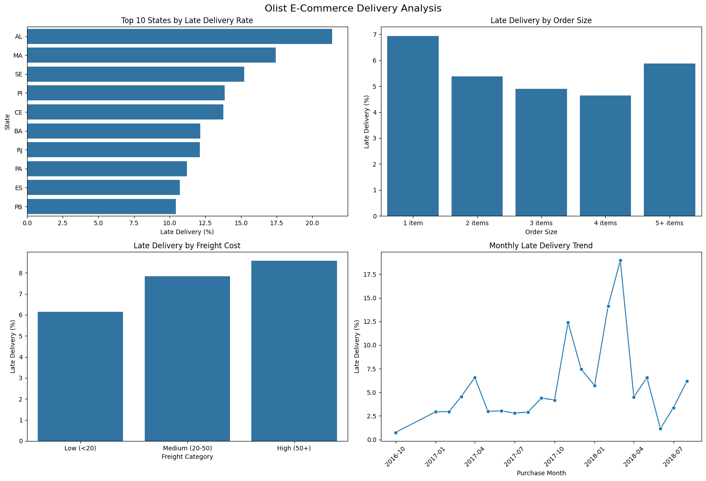

# Olist E-Commerce Late Delivery Prediction

## Project Overview

This project analyzes late deliveries in the Brazilian E-Commerce Public Dataset by Olist and builds machine learning models to identify orders at risk of late delivery.

The project combines SQL-based data preparation, exploratory data analysis (EDA), feature engineering, and machine learning.

## Dataset

- Source: [Brazilian E-Commerce Public Dataset by Olist](https://www.kaggle.com/datasets/olistbr/brazilian-ecommerce)
- License: CC BY-NC-SA 4.0
- Original data includes customers, orders, order items, payments, reviews, products, sellers, and geolocation.
- The analytical dataset contains 96,470 delivered orders.
- Target: whether the actual delivery calendar date was later than the estimated delivery calendar date.
- On-time orders: 89,936 (93.23%)
- Late orders: 6,534 (6.77%)

The dataset is imbalanced, with substantially fewer late orders.

## Project Structure

```text
olist-late-delivery-prediction/
├── data/
│   ├── raw/
│   └── processed/
├── notebooks/
│   └── Olist_Late_Delivery_Prediction.ipynb
├── sql/
├── reports/
│   └── eda_summary.png
├── models/
├── src/
└── README.md
```

## Data Preparation and SQL

- Imported the nine original CSV datasets into PostgreSQL.
- Created aggregated SQL views for order items, payments, and reviews.
- Built an order-level analytical dataset with one row per delivered order.
- Checked duplicate records and key relationships.
- Preserved raw source data and performed analysis using aggregated data.

## Exploratory Data Analysis

EDA examined:
- Late delivery rates by customer state.
- Relationship between freight cost and late deliveries.
- Order size and delivery outcomes.
- Monthly late delivery trends.

A chi-square test found an association between customer state and late delivery status (p < 0.001). This indicates association, not causation.



## Feature Engineering

Features included:
- Customer state
- Purchase month, day of week, and hour
- Total items and unique sellers
- Total product value and freight
- Freight-to-value ratio
- Average item price
- Maximum payment installments
- Promised delivery duration

Features that would only be known after delivery, such as actual delivery duration and review scores, were excluded to avoid target leakage.

## Modeling

A chronological 80/20 train-test split was used to evaluate performance on later orders.

Models:
1. Dummy Classifier (most frequent class)
2. Logistic Regression
3. Random Forest

Preprocessing for Logistic Regression included:
- One-hot encoding for customer state.
- Median imputation and standardization for numerical features.
- Most-frequent imputation for categorical features.
- Class weighting to account for class imbalance.

## Test Results

### Dummy Classifier

- Accuracy: 96.51%
- Late-order recall: 0.00%
- Confusion matrix: `[[18620, 0], [674, 0]]`

The high accuracy is misleading because the model predicts every order as on-time and detects no late orders.

### Logistic Regression (default threshold)

- Accuracy: 57.42%
- ROC-AUC: 0.7003
- Late-order precision: 0.06
- Late-order recall: 0.77
- Late-order F1-score: 0.11
- Confusion matrix: `[[10560, 8060], [156, 518]]`

The model detects 518 of 674 late orders, but produces many false positives.

### Random Forest

- Accuracy: 93.19%
- ROC-AUC: 0.636
- Late-order precision: 0.07
- Late-order recall: 0.07
- Late-order F1-score: 0.07
- Confusion matrix: `[[17932, 688], [625, 49]]`

Random Forest achieves higher accuracy but misses most late orders.

## Threshold Experiment

A separate validation period was used to select a Logistic Regression probability threshold of 0.668, maximizing validation F1-score (0.2563).

On the test set:
- Accuracy: 84.16%
- ROC-AUC: 0.7003
- Late-order precision: 0.06
- Late-order recall: 0.26
- Late-order F1-score: 0.10
- Confusion matrix: `[[16060, 2560], [497, 177]]`

This threshold reduced false positives but also reduced late-order recall. It is an alternative operating point, not an overall improvement.

## Limitations

- The late-order class is highly imbalanced.
- The late-order rate differs between the training period (7.59%) and test period (3.49%), indicating temporal distribution shift.
- Late-order precision is low, so many flagged orders are actually on-time.
- No extensive cross-validation or hyperparameter search was performed.
- Results are experimental and are not production-ready.

## Future Improvements

- Evaluate additional models and imbalance-handling techniques.
- Explore time-aware validation and probability calibration.
- Investigate additional features available at order placement.
- Monitor performance as delivery patterns change.

## Reproducibility

The main analysis and modeling workflow is available in:

`notebooks/Olist_Late_Delivery_Prediction.ipynb`

## Acknowledgement

Dataset: Brazilian E-Commerce Public Dataset by Olist, available on Kaggle. Please follow its CC BY-NC-SA 4.0 license and attribution requirements.
